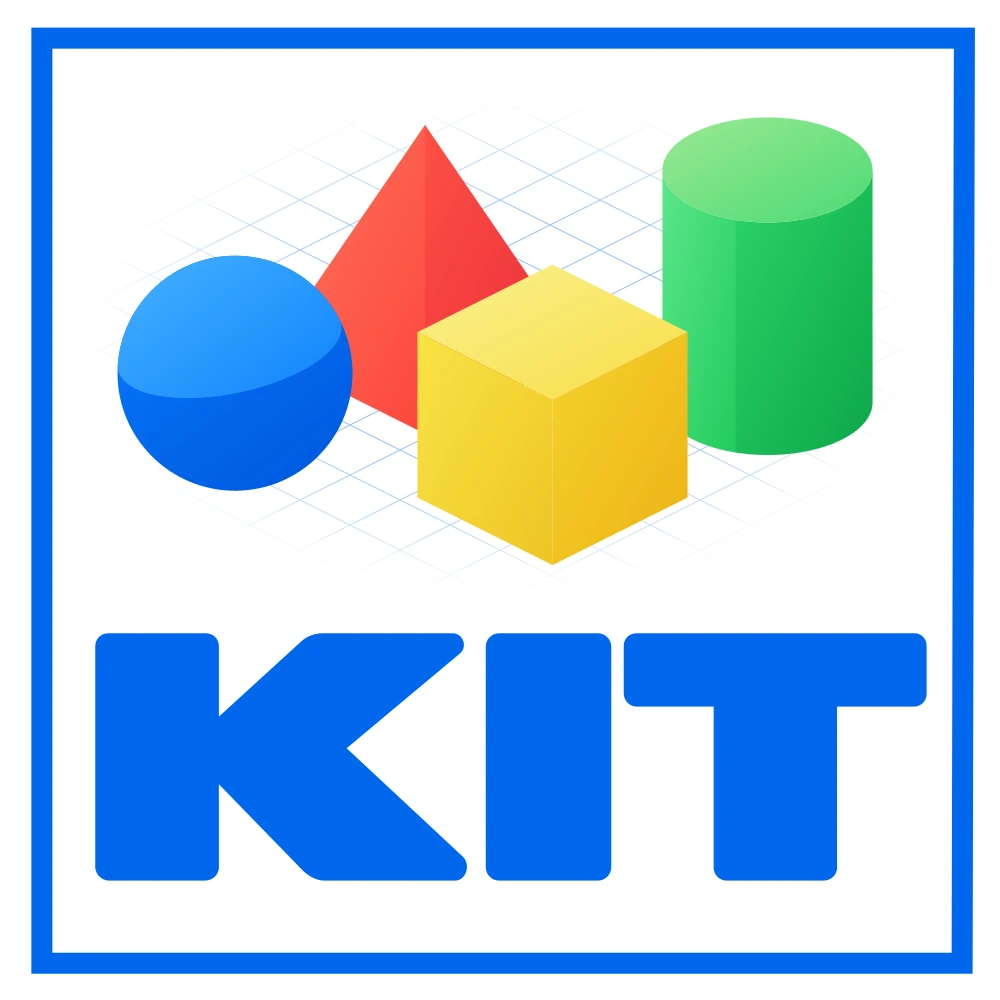

# kit

<p align="center">
  
</p>


[](#license)

kit is a content-addressed version control system written in Rust. It has
commits, refs, branches and remotes. It treats signatures and attestations as
part of the object model.

- Every object ID is the BLAKE3 hash of the canonical bytes of the object.
- Every commit carries an Ed25519 signature.
- `kit attest` stores in-toto v1 Statements in DSSE envelopes. The commit hash
  is the subject.
- Large files split into content-defined chunks. A small edit stores only the
  edit.

> [!NOTE]
> kit is alpha software (pre-1.0). The specs in [`docs/specs/`](docs/specs/README.md)
> and the golden vectors in [`rust/tests/golden/`](rust/tests/golden/) define
> the formats. APIs and CLI flags can change in any 0.x release.

## Install

```sh
curl -sSfL https://kit.storage/install.sh | sh
```

The script downloads the release archive for your platform. It verifies the
cosign signature of the archive, then the SHA256 sum. It installs `kit` into
`~/.local/bin`.

cosign verification is on by default. The script stops if `cosign` is not in
`PATH`. The script accepts only archives that the `release.yml` workflow of this
repository signed at a semver tag.

To pin a version, pass `--version`:

```sh
curl -sSfL https://kit.storage/install.sh | sh -s -- --version v0.5.0
```

To build from source, use Rust 1.99 or newer:

```sh
cargo install --git https://github.com/officialunofficial/kit kit-bin
```

kit supports Linux and macOS. On Windows, run kit under
[WSL](https://learn.microsoft.com/windows/wsl/). The Linux release archives
need glibc 2.39 or newer. [`docs/INSTALL.md`](docs/INSTALL.md) covers pinned
versions, manual verification and updates.

## Quick start

```sh
kit init                       # create .kit/ in the current directory
kit keygen                     # generate an Ed25519 signing key
echo hello > hi.txt
kit add hi.txt
kit commit -m "first commit"
kit log
```

The commit is signed with your key. To share it, add a remote and push:

```sh
kit remote add origin kit+file:///srv/kit/my-repo
kit push origin
```

Attest to the commit. Then verify the attestation against keys that you trust:

```sh
kit attest --predicate-type https://example.com/sign-off/v1
kit keygen --print-pubkey                 # prints ed25519:<hex>
kit trust add ed25519:<hex> <hex>         # trust your own key
kit verify-attest
```

`kit verify-attest` trusts only the keys in your user-level trust-roots file. It
refuses a trust-roots file inside the repository unless you pass the path
explicitly. See [`docs/CLI.md`](docs/CLI.md) for every command. If you come
from Git, read [`docs/GUIDE-GIT-WORKFLOWS.md`](docs/GUIDE-GIT-WORKFLOWS.md).

## Non-goals

- **No shallow clone.** `kit clone --depth N` is rejected with a usage error.
  kit never silently makes a full clone when you ask for a shallow one.
- **No import of older repository layouts.** kit reads only repositories in
  its own `.kit/` layout. To bring history in, use `kit git import` on a Git
  upstream.
- **No Windows build.** Use WSL.
- **No transport fallback.** The URL scheme picks the transport. kit does not
  try another one when the first fails.
- **No meaning for attestation predicates.** kit moves and verifies the bytes.
  The consumer decides what a predicate means.

## Documentation

| Doc | For |
|---|---|
| [`docs/INSTALL.md`](docs/INSTALL.md) | Install channels, verification, updates |
| [`docs/CLI.md`](docs/CLI.md) | Subcommands, config keys, exit codes |
| [`docs/GUIDE-GIT-WORKFLOWS.md`](docs/GUIDE-GIT-WORKFLOWS.md) | Git users and Git upstreams |
| [`docs/PARITY.md`](docs/PARITY.md) | Where kit matches Git and where it differs |
| [`docs/VERIFY.md`](docs/VERIFY.md) | Verify a commit hash without repository access |
| [`docs/specs/`](docs/specs/README.md) | Wire-format and subsystem specs |
| [`docs/ARCHITECTURE.md`](docs/ARCHITECTURE.md) | Crate layout |
| [`docs/LIBKIT.md`](docs/LIBKIT.md) | Embed kit with the `libkit` crate |
| [`docs/THREAT-MODEL.md`](docs/THREAT-MODEL.md) | Security boundaries |
| [`docs/RELEASE.md`](docs/RELEASE.md) | How a release is cut |

## Build and contribute

```sh
cd rust
cargo build --release          # binary: rust/target/release/kit
cargo test --workspace
```

[`CONTRIBUTING.md`](CONTRIBUTING.md) lists the checks that a change must pass.
[`GOVERNANCE.md`](GOVERNANCE.md) and [`MAINTAINERS.md`](MAINTAINERS.md) describe
who decides. Everyone who takes part follows the
[`CODE_OF_CONDUCT.md`](CODE_OF_CONDUCT.md). To report a security issue, follow
[`SECURITY.md`](SECURITY.md).

## License

kit is dual-licensed under [MIT](LICENSE-MIT) or [Apache-2.0](LICENSE-APACHE), at
your option. Unless you state otherwise, any contribution that you submit for
inclusion is dual-licensed the same way.
