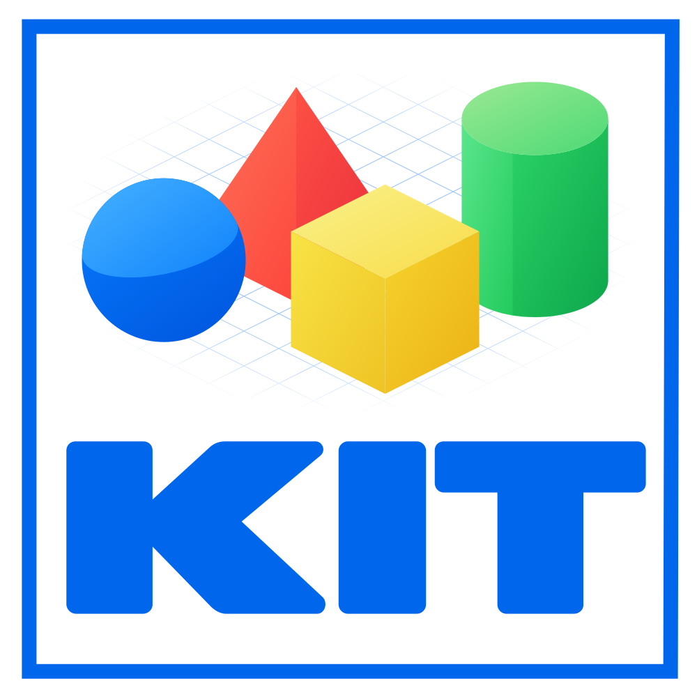

# KIT logo

Four geometric solids sit above wide KIT lettering inside a square border.
The blue sphere, red pyramid, yellow cube, and green cylinder suggest building
blocks that fit together. Their shared perspective makes them one composition.

Subtle face gradients give the solids depth without cast shadows. A curved
seam defines the sphere's two-tone surface. The lettering and border use Uno
blue, `#0067ed`. The wide letters anchor the composition and fill the square.

The Uno-blue perspective grid is strongest near the shapes. A radial gradient
mask fades it toward the edges, keeping attention on the solids and name.

## Assets

| Variant | Vector | Raster |
|---|---|---|
| Fading grid | [SVG](kit-logo-grid.svg) | [PNG](kit-logo-grid.png) |
| Clean | [SVG](kit-logo-clean.svg) | [PNG](kit-logo-clean.png) |

The SVGs scale without losing detail. Each PNG is 1000 by 1000 pixels with a
white background. Use the clean variant when the grid loses detail at small
sizes. Preserve the colors, proportions, lettering, and border.

These exports are committed so documentation and other consumers can use the
approved artwork directly without a rendering dependency.

## Source of truth

The [logo Kit](https://uno.fun/01a15ada-9a3a-73f1-b3a0-9110d4efd027/kit-logo)
holds the editable drawing source and signed design history. These assets match
revision `0e5d198f96f2d3e4207d25d5fdec7256c228cd94311cae6511b8af0774c6cc1d`.

Make design edits in the logo Kit and record each iteration in a separate
signed commit. Export both variants from the same revision and update this
reference together with the assets.
