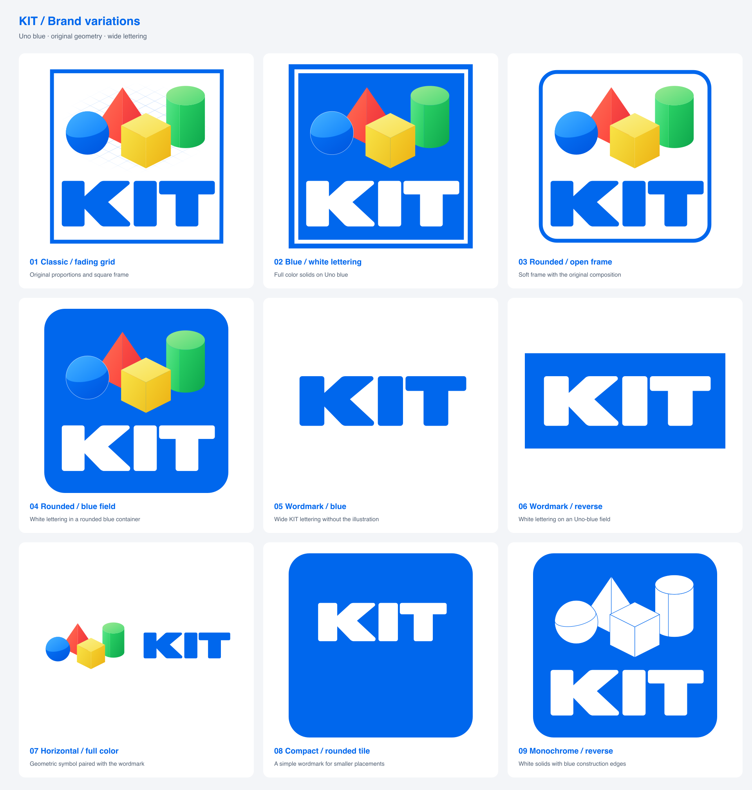
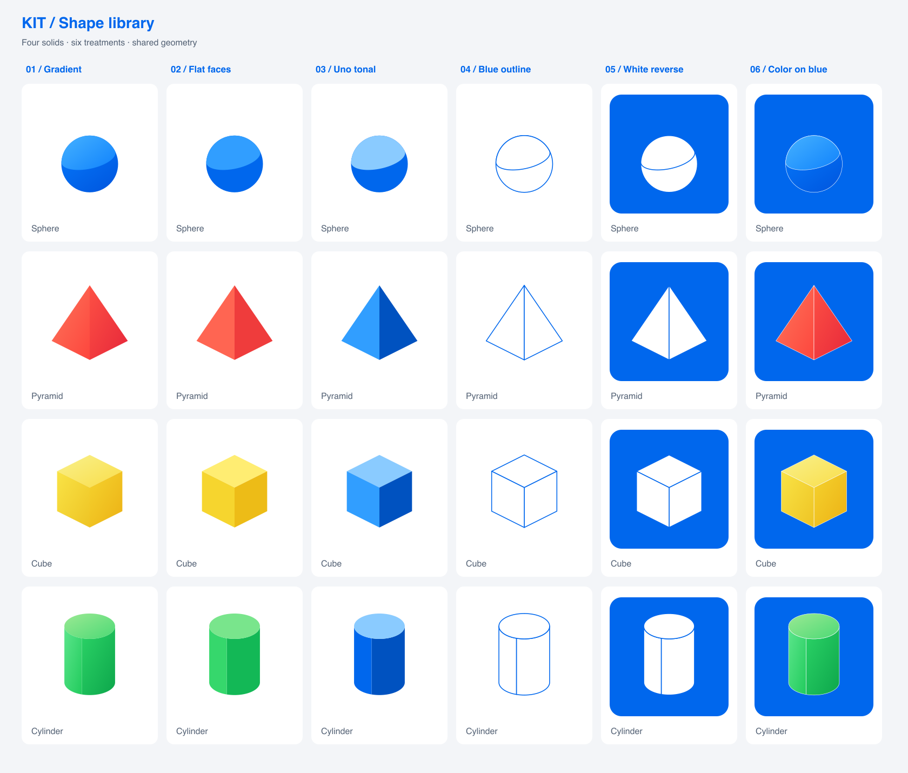
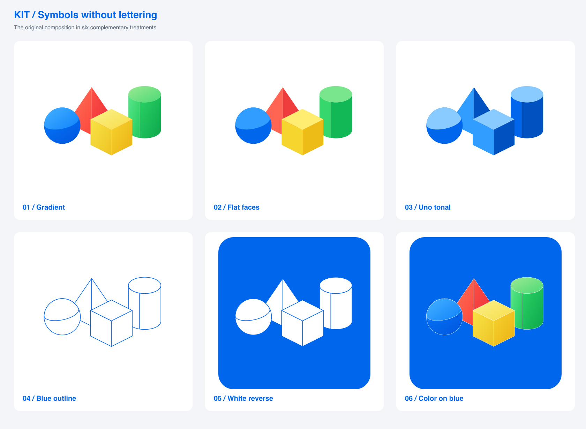

# KIT brand assets

The logo and shape libraries provide alternate artwork for different sizes
and backgrounds. These exported assets are committed for direct use in
documentation and other surfaces without a rendering dependency.

## Logo variations

| Treatment | SVG | PNG |
|---|---|---|
| Classic grid | [Vector](variations/01-classic-grid.svg) | [Raster](variations/01-classic-grid.png) |
| Blue background, white lettering | [Vector](variations/02-blue-reverse.svg) | [Raster](variations/02-blue-reverse.png) |
| Rounded open frame | [Vector](variations/03-rounded-frame.svg) | [Raster](variations/03-rounded-frame.png) |
| Rounded blue field | [Vector](variations/04-rounded-blue.svg) | [Raster](variations/04-rounded-blue.png) |
| Blue wordmark | [Vector](variations/05-wordmark-blue.svg) | [Raster](variations/05-wordmark-blue.png) |
| White wordmark on blue | [Vector](variations/06-wordmark-reverse.svg) | [Raster](variations/06-wordmark-reverse.png) |
| Horizontal composition | [Vector](variations/07-horizontal.svg) | [Raster](variations/07-horizontal.png) |
| Compact rounded tile | [Vector](variations/08-compact.svg) | [Raster](variations/08-compact.png) |
| Monochrome reverse | [Vector](variations/09-monochrome.svg) | [Raster](variations/09-monochrome.png) |

## Individual shapes

Each sphere, pyramid, cube, and cylinder has six treatments. The numbered
suffix identifies the treatment. Each individual asset has matching SVG and
800 by 800 PNG files in [shapes/](shapes/).

| Suffix | Treatment | Sphere example |
|---|---|---|
| 01 | Original face gradients | [SVG](shapes/sphere-01.svg) |
| 02 | Flat face colors | [SVG](shapes/sphere-02.svg) |
| 03 | Uno-blue tones | [SVG](shapes/sphere-03.svg) |
| 04 | Blue outlines | [SVG](shapes/sphere-04.svg) |
| 05 | White on rounded blue tiles | [SVG](shapes/sphere-05.svg) |
| 06 | Color on rounded blue tiles | [SVG](shapes/sphere-06.svg) |

Individual solids share a scale and baseline within their canvases. The first
four treatments have transparent canvases. Outline faces are opaque white to
hide edges behind them.

## Grouped symbols

The six grouped symbols preserve the original arrangement without the KIT
lettering or border. Files **composition-01** through **composition-06** use
the same treatments as the individual shapes. Each has SVG and PNG exports
in [shapes/](shapes/).

## Source

The [logo Kit](https://uno.fun/01a15ada-9a3a-73f1-b3a0-9110d4efd027/kit-logo)
holds the editable drawing source and signed history. These exports match
revision `fed4d1c0a92af13a0195ad57a23cf95f0ad307d8c562bbd124511e0342a25771`.
The primary grid and clean logos remain unchanged.

The source build produces the approved logos, alternate logos, individual
shapes, grouped symbols, and comparison sheets. Export both formats from the
same revision. Preserve the aspect ratios and update the revision reference
when replacing assets.

## Web assets

[Favicons and social cards](WEB.md) includes a proportional KIT favicon, an Uno-blue
Open Graph example, source rendering code, and page metadata guidance.
