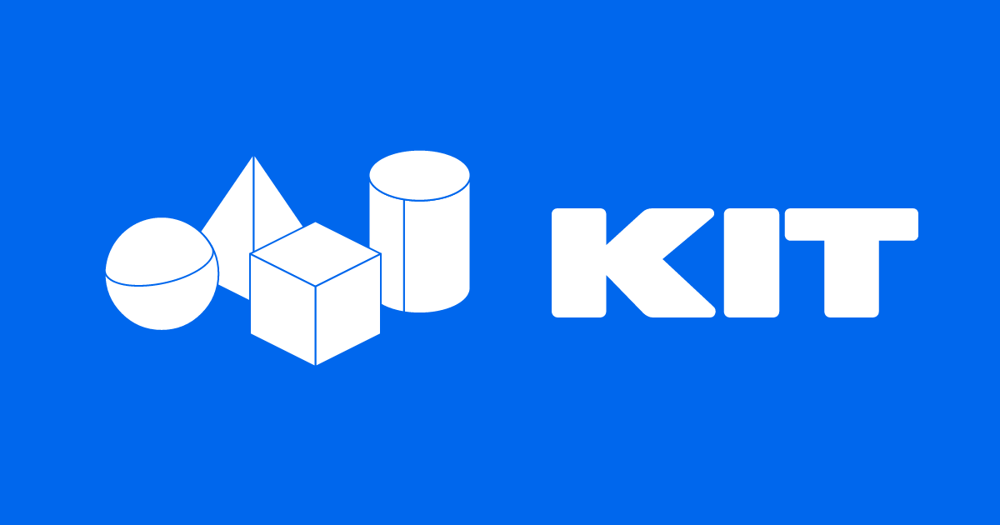

# Favicons and social cards

## Favicon

The favicon uses the complete outlined KIT wordmark in white on an Uno-blue
rounded tile. A single uniform scale preserves its original 66.51 by 19.79
unit proportions, letter spacing, and contours. The wordmark fills 60 units
of the 64-unit canvas width and remains centered vertically.

At 16 pixels, the lettering is about 4.46 pixels tall. Higher-resolution
exports improve larger and high-density presentations but do not add detail
to a 16-pixel display slot.

| Asset | Purpose |
|---|---|
| [favicon.svg](favicon/favicon.svg) | Scalable browser icon |
| [favicon.ico](favicon/favicon.ico) | Fallback with 16, 32, 48, 64, 128, and 256 pixel images |
| [16 pixel PNG](favicon/favicon-16.png) | Small browser tab preview |
| [32 pixel PNG](favicon/favicon-32.png) | Raster browser icon |
| [48 pixel PNG](favicon/favicon-48.png) | Larger browser icon |
| [64 pixel PNG](favicon/favicon-64.png) | High-density tab icon |
| [96 pixel PNG](favicon/favicon-96.png) | Search and larger icon surfaces |
| [128 pixel PNG](favicon/favicon-128.png) | Larger raster icon |
| [180 pixel PNG](favicon/favicon-180.png) | Rounded raster icon |
| [192 pixel PNG](favicon/favicon-192.png) | Larger raster icon |
| [256 pixel PNG](favicon/favicon-256.png) | High-resolution raster icon |
| [512 pixel PNG](favicon/favicon-512.png) | Largest raster export |
| [Apple touch PNG](favicon/apple-touch-icon.png) | 180 pixel square touch icon |

The touch icon has a full blue square background so the platform can apply
its mask. The browser favicon retains transparent rounded corners. Every PNG is rendered
directly from the vector source at its target dimensions.

Google Search requires a square favicon of at least 8 pixels and recommends
one larger than 48 pixels. Its supported format list includes PNG and ICO.
Keep a stable, crawlable raster URL on the home page alongside the scalable
SVG browser icon. Appearance in search results is not guaranteed.

Copy the files to the site's public root and include:

```html
<link rel="icon" href="/favicon.ico" sizes="16x16 32x32 48x48 64x64 128x128 256x256">
<link rel="icon" href="/favicon-96.png" type="image/png" sizes="96x96">
<link rel="icon" href="/favicon.svg" type="image/svg+xml" sizes="any">
<link rel="apple-touch-icon" href="/apple-touch-icon.png" sizes="180x180">
<meta name="theme-color" content="#0067ed">
```

## Open Graph card



The example is 1200 by 630 pixels. It uses a solid Uno-blue background,
white solids, blue construction edges, and the outlined white KIT wordmark.
A 72 pixel layout inset keeps the composition away from the canvas edges.
The layout omits the border and grid to keep the card clear at preview sizes.

The rendered PNG is committed as a ready-to-use example. The source under
[og/](og/) uses `@officialunofficial/og` for the layout and response rendering.
Both images are embedded as SVG data URIs. Outlined lettering avoids a font
request and preserves the custom wordmark.

### Run the example

```sh
python3 docs/brand/generate-web-assets.py
cd docs/brand/og
bun install --frozen-lockfile
bun run test
bun run build
bun run dev
```

In another terminal, from the repository root:

```sh
curl --fail http://localhost:8791/og.png -o docs/brand/og/example.png
```

The generator needs Python 3 and `rsvg-convert`. It derives favicon and white
OG artwork from the existing brand SVGs. The development server runs locally.
The build checks packaging without deploying anything. The example serves
only GET and HEAD requests to **/og.png**, returning PNG content and a one-hour
public cache header. Rendering is shared across concurrent requests and reused
within each server instance. HEAD returns headers without rendering. Unknown
paths return 404; other methods return 405.

The exported PNG can be served as a static file without running the example
server in production. Use a versioned URL when replacing a static card because
social platforms cache previews. Keep the downloaded PNG visually aligned
with the current card source.

### Page metadata

After hosting the image, use its absolute HTTPS URL. The paths below assume
the site publishes this PNG at **/brand/og-kit-v1.png**. Adapt the canonical
page URL, title, description, and image path for the actual page.

```html
<meta property="og:type" content="website">
<meta property="og:site_name" content="KIT">
<meta property="og:title" content="KIT — Signed version control">
<meta property="og:description" content="Content-addressed version control with signed commits and attestations.">
<meta property="og:url" content="https://kit.storage/">
<meta property="og:image" content="https://kit.storage/brand/og-kit-v1.png">
<meta property="og:image:type" content="image/png">
<meta property="og:image:width" content="1200">
<meta property="og:image:height" content="630">
<meta property="og:image:alt" content="White geometric solids beside the KIT wordmark on an Uno-blue background.">
<meta name="twitter:card" content="summary_large_image">
<meta name="twitter:title" content="KIT — Signed version control">
<meta name="twitter:description" content="Content-addressed version control with signed commits and attestations.">
<meta name="twitter:image" content="https://kit.storage/brand/og-kit-v1.png">
<meta name="twitter:image:alt" content="White geometric solids beside the KIT wordmark on an Uno-blue background.">
```

Serve the page metadata in the initial HTML. The image URL must return the
PNG directly without authentication. Check the published page and card with
social preview inspectors after integrating them. These assets do not install
a favicon, change site metadata, or publish an endpoint by themselves.

## Canonical artwork

The favicon and card source are recorded in the
[logo Kit](https://uno.fun/01a15ada-9a3a-73f1-b3a0-9110d4efd027/kit-logo)
at revision `1b9054c639c7ede11d7aa43f4d21e9952486ab5fc101ff2677cb7a5c1c69b65b`.
The browser ICO and SVG files are local exports from that source.

## References

- [Open Graph protocol](https://ogp.me/) defines image and page metadata.
- [Package API](https://www.npmjs.com/package/@officialunofficial/og)
  documents the layout primitives, data URIs, and rendering response.
- [Wrangler configuration](https://developers.cloudflare.com/workers/wrangler/configuration/)
  describes local configuration and asset module rules.

- [Google favicon guidance](https://developers.google.com/search/docs/appearance/favicon-in-search)
  covers square dimensions, raster formats, stable URLs, and crawling.
- [WebKit SVG icon support](https://webkit.org/blog/17333/webkit-features-in-safari-26-0/)
  describes scalable favicons in Safari 26.
